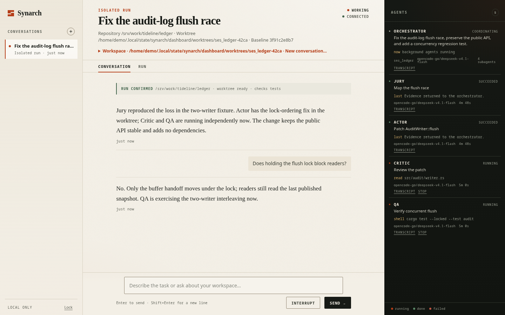
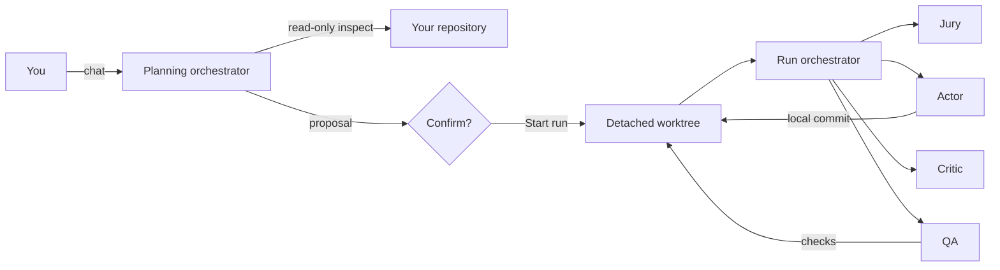
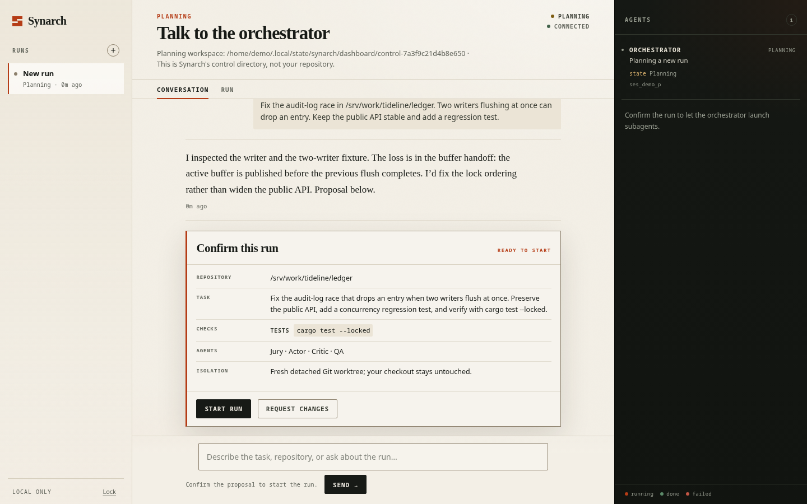
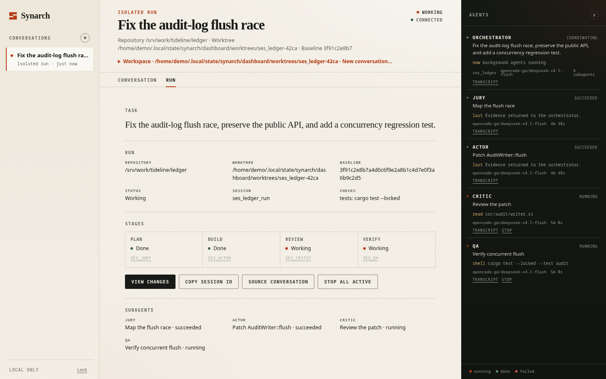
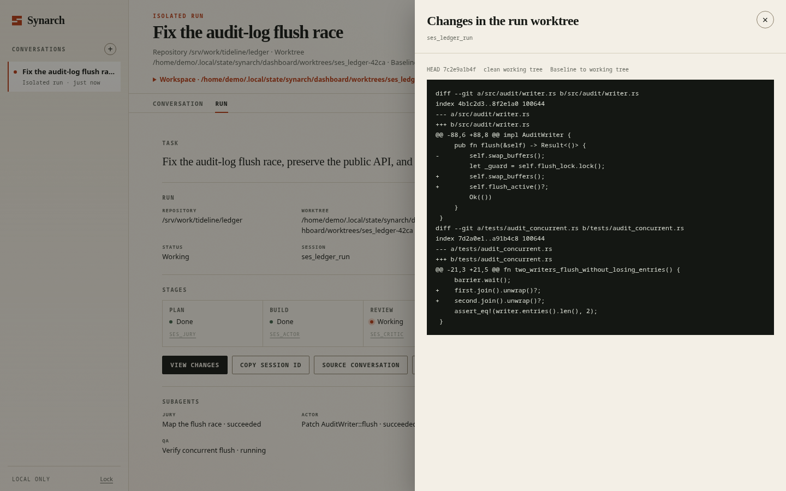
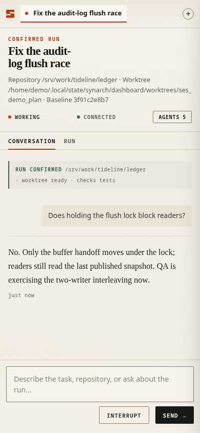

<p align="center">
  
</p>

<h1 align="center">Synarch</h1>

<p align="center">
  <strong>A conversational orchestrator for evidence-gated coding work.</strong><br>
  Native OpenCode subagents · isolated worktrees · a local-first control room.
</p>

<p align="center">
  
  
  
</p>

<p align="center">
  
</p>

<p align="center">
  <sub>One confirmed run: the orchestrator, four isolated subagents, live tool activity, and the isolated worktree path.</sub>
</p>

---

## Two ways to run

|  | Orchestrator console | Evidence-gated controller |
| --- | --- | --- |
| **Start** | `synarch app` | `synarch create` + `synarch run` |
| **Interface** | Conversation with a primary orchestrator | Strict typed role reports |
| **Planning** | Read-only inspection, proposal card, explicit approval | Jury plan |
| **Execution** | Native OpenCode subagents in a detached worktree | Actor → checks → Critic → Jury → QA |
| **Acceptance** | Human review of transcripts and diff | Rust-enforced checks and acceptance gates |
| **State** | OpenCode sessions and session metadata | SQLite ledger |

The console is the conversational surface. The Rust controller remains a
separate CLI workflow when you need deterministic acceptance evidence. The
console does **not** use the controller's gates.

## What a run feels like



1. **Talk.** Tell the orchestrator the repository, the task, and how you want it
   verified. It can inspect the repository without executing anything.
2. **Confirm.** The orchestrator returns a structured proposal. Synarch shows it
   as a card with the repository, task, checks, agents, and isolation. Nothing is
   created or started until you press **Start run**.
3. **Watch.** Synarch creates a detached worktree and a fresh run orchestrator.
   The orchestrator launches the native Jury, Actor, Critic, and QA subagents.
   The agents rail shows every session, current tool or target, model, duration,
   and outcome.
4. **Review.** Open any agent's transcript. Read the baseline-to-working-tree
   diff. Interrupt one subagent or the whole run. The planning transcript stays
   available under **Run → Planning transcript**.

Screenshots use a fictional repository and mocked session data.

### Planning and confirmation



*The planning orchestrator runs in Synarch's control workspace, not your
repository. The workspace path is shown in the header. Your checkout is untouched
until you confirm.*

### Inside a confirmed run



*All work happens in the detached worktree. Jury and Actor are done; Critic and
QA are running independently. `Stop all active` interrupts the live subagents.*

### Review the diff



*The diff drawer compares the recorded baseline with the current working tree.
Large diffs are capped at 128 KiB.*

### On a phone

<p align="center">
  
</p>

<p align="center">
  <sub>The main conversation stays first. Agents open in a sheet with a backdrop and focus trap.</sub>
</p>

## Why it is safe to point at a repository

- **Planning is permission-denied.** The planning orchestrator has no shell or
  edit tools. It cannot touch your checkout; Synarch performs bounded read-only
  inspection on its behalf.
- **Nothing starts without approval.** The proposal is bound to the assistant
  message you saw. An old proposal cannot be started; the card is the approval
  point for provider spend.
- **Work is isolated.** A run gets a detached Git worktree at the recorded
  baseline. The original repository stays clean.
- **Roles have different tools.** Jury is read-only. Actor can edit and run
  commands. Critic gets read plus read-only Git inspection. QA can run checks but
  cannot edit.
- **Publishing is denied.** `git push`, `git remote`, `gh pr`, and `gh release`
  are denied for the Actor and QA.
- **No automatic merge, push, deploy, or worktree cleanup.** Review the diff and
  merge through your own release process.

The console is not a sandbox. Worktrees share Git metadata and the host account,
and agents run with host authority. See [limits](#limits-and-trust-boundary).

## Agents

| Agent | Mode | What it can do |
| --- | --- | --- |
| **Planning orchestrator** | primary | Ask the host to inspect a repository; propose a run. No shell or edit tools. |
| **Run orchestrator** | primary | Delegate to the four Synarch subagents. No edit or shell tools itself. |
| **Jury** | subagent | Read, glob, and grep. Map the problem, plan, and review evidence. |
| **Actor** | subagent | Read, edit, and shell. Implement, test, and create a local Conventional Commit. |
| **Critic** | subagent | Read plus read-only Git commands. Independent review. |
| **QA** | subagent | Read and shell. Run the agreed checks independently; no edits. |

Generated agent definitions live at `<db-parent>/dashboard/opencode.json`.
Planning workspaces are versioned by config hash so an upgrade never reuses a
stale OpenCode agent cache.

## Quick start

Requirements:

- Rust 1.89+ and Git
- A running OpenCode **V2** server with a provider connected
- A clean target Git repository with an initial commit and Git author identity
- A modern browser with JavaScript for the console
- Linux is the initial tested platform

Start the console from an interactive terminal:

```sh
cargo run --locked -- app --port 8788
```

Open the printed loopback URL and enter the one-time code shown in the terminal.
It expires after five minutes or ten failed attempts. A browser session lasts one
hour and is invalidated when the app stops.

Then tell the orchestrator what to do. For example:

> Work in `/srv/work/tideline/ledger`. Fix the audit-log race that drops an entry
> when two writers flush at once. Keep the public API stable, add a concurrency
> regression test, and use `cargo test --locked`.

The default model is `opencode-go/deepseek-v4.1-flash`. Override it with a
`provider/model` reference:

```sh
SYNARCH_MODEL=your-provider/your-model cargo run --locked -- app --port 8788
```

The console auto-discovers the managed OpenCode service. Explicit
`SYNARCH_OPENCODE_URL` and `SYNARCH_OPENCODE_AUTHORIZATION` values take
precedence. Credentials are never returned to the browser.

### State and storage

The console uses `<db-parent>/dashboard/` and does not open or write the Synarch
SQLite database. The default `--db` path is
`$XDG_STATE_HOME/synarch/state.sqlite`, or
`$HOME/.local/state/synarch/state.sqlite`. Keep it outside the project checkout.

```text
dashboard/
  opencode.json      generated Synarch agent definitions
  control-<hash>/    planning sessions for this generated config
  worktrees/         one isolated worktree per run
```

OpenCode sessions and metadata are the run registry and conversation store.
Closing the console does not stop OpenCode sessions or subagents already running.

## The evidence-gated controller

The original controller owns every transition:

```text
Jury plan → Actor → mandatory checks → Critic → Jury decision → QA → ready
              ↑                                  │            │
              └──────────── Jury-directed rework ─┴── triage ──┘
```

It gives you strict typed reports, role attribution from the reserved assignment,
an isolated Actor worktree, deterministic argv checks, a separate QA worktree,
SQLite state and an ordered event ledger, and explicit recovery controls. Role
selection, transitions, checks, and gates are enforced in Rust; model text is
untrusted structured input, and SQL is parameterized.

The controller needs its agent profiles and workflow config. Copy
[`examples/workflow.json`](examples/workflow.json), merge
[`examples/opencode.jsonc`](examples/opencode.jsonc) into the configuration
OpenCode loads, set `SYNARCH_OPENCODE_URL`, and review the target repository
requirements before creating a run. The console generates its own agent
definitions and does not need that merge.

```sh
# Journal a run (does not launch agents)
cargo run --locked -- create --config /path/to/workflow.json \
  --request 'Fix shutdown handling'

# Advance until ready/escalated, an error, or the poll limit
cargo run --locked -- run RUN_ID --max-polls 200

# Inspect and recover
cargo run --locked -- status RUN_ID
cargo run --locked -- attempts RUN_ID
cargo run --locked -- events RUN_ID
cargo run --locked -- pause RUN_ID
cargo run --locked -- resume RUN_ID
cargo run --locked -- cancel RUN_ID --reason 'Stop this workflow'
cargo run --locked -- retry RUN_ID --reason 'Reconcile the stopped worker'
```

The read-only ledger dashboard remains available (it requires an existing
version 2 database):

```sh
cargo run --locked -- dashboard --port 8787
```

`ready` means engineering acceptance plus QA validation for the recorded commit.
It does not authorize a merge, push, deployment, or release.

See [recovery operations](docs/recovery.md) for retries, cancellation, escalation,
budgets, and the schema upgrade path.

## Build and test

```sh
cargo build --locked
cargo test --locked
cargo clippy --locked --all-targets -- -D warnings
cargo fmt --check
cargo audit
```

Tests use real temporary Git repositories and SQLite databases. Console tests use
a fake OpenCode backend and spend no model credits. A manual live console run was
completed on OpenCode 2.2.5: planning, inspection, proposal confirmation, worktree
creation, all four native subagents, transcripts, diff, and a clean local commit.
That is one verified flow, not a reliability guarantee. The controller live tests
are documented in [the smoke-test report](docs/live-smoke-test.md).

## Limits and trust boundary

- The console has **no deterministic acceptance gate**. The QA subagent runs the
  agreed checks and the UI shows evidence, but the orchestrator decides when work
  is done. Use the gated controller when you need Rust-owned acceptance.
- There is **no hard token or cost cap** in the console. The proposal card is the
  approval point; a run can spend provider allowance.
- **Worktrees are not sandboxes.** Agents share Git metadata and the host account.
  Use separate OS identities or containers before running untrusted repositories.
- The read-only database dashboard has **no authentication** and binds to loopback.
  Do not forward it. The console has a one-time code, a Secure HttpOnly session
  cookie, exact loopback Host/Origin checks, and CSRF-protected mutations.
- OpenCode V2 HTTP behavior, including native subagents and session permissions,
  is experimental. Pin your OpenCode build and run a live smoke test.
- Session data, transcripts, prompts, and diffs can contain secrets. Protect
  OpenCode storage and the Synarch state root.
- This is a single-user, single-host MVP. There is no multi-user auth, distributed
  scheduler, automatic merge, or deployment integration.

## Docs

- [Orchestrator console operations](docs/orchestrator-console.md) — lifecycle,
  generated agents, permission inheritance, state root, troubleshooting
- [Recovery operations](docs/recovery.md) — retries, cancellation, escalation,
  budgets, schema upgrades
- [Live controller smoke test](docs/live-smoke-test.md)
- [Live rework harness](docs/live-rework-test.md)
- [Live cancellation report](docs/live-cancellation-test.md)
- [Local access security boundary](SPEC-local-access.md)

## Layout

| Path | Responsibility |
| --- | --- |
| `src/app.rs` | Protected console HTTP server and local access |
| `src/console.rs` | Orchestrator state, proposals, native runs, activity, diff |
| `src/console.html` · `.css` · `.js` | Console shell and assets |
| `src/opencode.rs` | OpenCode V2 client, durable dispatch, new session/chat API |
| `src/controller.rs` | Evidence-gated single-Actor coordination |
| `src/engine.rs` | Acceptance, authority, and invalidation guards |
| `src/store.rs` · `src/store/` | SQLite ledger, attempts, controls, migrations |
| `src/workspace.rs` | Git worktrees, snapshots, bounded checks |
| `src/dashboard.rs` · `src/dashboard.html` | Read-only ledger dashboard |
| `src/main.rs` | CLI commands and the app entry point |

<p align="center">
  <sub>Synarch is a local-first project. Do not expose its loopback listeners or run untrusted repositories on a shared host.</sub>
</p>
