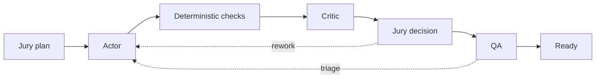

<p align="center">
  
</p>

<h1 align="center">Synarch</h1>

<p align="center">
  <strong>Evidence-gated multi-agent development on OpenCode V2.</strong><br>
  Strict role reports · isolated worktrees · deterministic checks · a local ledger.
</p>

<p align="center">
  
  
  
</p>

---

Synarch has two surfaces:

|  | This repository | OpenCode plugin |
| --- | --- | --- |
| **What** | Evidence-gated controller + read-only ledger dashboard | Conversational orchestrator, workers and live agent activity |
| **Where** | `synarch` CLI | Inside the OpenCode TUI |
| **Interface** | Typed role reports | Chat with a `synarch` agent |
| **Acceptance** | Rust-enforced checks and gates | Human review of evidence and diff |
| **State** | SQLite ledger | OpenCode sessions and metadata |

The interactive console that used to live in this repository has moved to the
separate `opencode-synarch` plugin. This repository is the controller: it is the
choice when acceptance must be mechanically enforced rather than judged from a
transcript.

## What the controller does



It gives you strict typed reports, role attribution from the reserved
assignment, an isolated Actor worktree, deterministic argv checks, a separate QA
worktree, SQLite state and an ordered event ledger, and explicit recovery
controls. Role selection, transitions, checks and gates are enforced in Rust;
model text is untrusted structured input and SQL is parameterized.

`ready` means engineering acceptance plus QA validation for the recorded commit.
It does not authorize a merge, push, deployment or release.

## Requirements

- Rust 1.89+ and Git
- A running OpenCode **V2** server with a provider connected
- A target Git repository with an initial commit and a configured Git author
- Linux is the initial tested platform

## Setup

Copy the example workflow and agent configuration:

```sh
cp examples/workflow.json /path/to/workflow.json
```

Merge [`examples/opencode.jsonc`](examples/opencode.jsonc) into the configuration
OpenCode loads, edit the repository and workspace paths in `workflow.json`, then
point Synarch at the server:

```sh
export SYNARCH_OPENCODE_URL=http://127.0.0.1:4096
# Optional, when the server requires it:
export SYNARCH_OPENCODE_AUTHORIZATION='Bearer …'
```

The default database is `$XDG_STATE_HOME/synarch/state.sqlite`, or
`$HOME/.local/state/synarch/state.sqlite`. Pass `--db` to put it elsewhere and
keep it outside the target checkout.

## Run a workflow

```sh
# Journal a run. Does not launch agents or modify the checkout.
cargo run --locked -- create --config /path/to/workflow.json \
  --request 'Fix shutdown handling'

# Advance until ready/escalated, an error, or the poll limit.
cargo run --locked -- run RUN_ID --max-polls 200
```

Inspect and recover:

```sh
cargo run --locked -- status RUN_ID
cargo run --locked -- attempts RUN_ID
cargo run --locked -- events RUN_ID
cargo run --locked -- pause RUN_ID
cargo run --locked -- resume RUN_ID
cargo run --locked -- cancel RUN_ID --reason 'Stop this workflow'
cargo run --locked -- retry RUN_ID --reason 'Reconcile the stopped worker'
```

`create` only journals intent. `step` and `run` require the configured server;
`pause` affects future scheduling and does not interrupt sessions already running.
See [recovery operations](docs/recovery.md) for retries, cancellation,
escalation, budgets and the schema upgrade path.

## Read-only ledger dashboard

The original inspection surface remains, and requires an existing version 2
database:

```sh
cargo run --locked -- dashboard --port 8787
```

It binds to IPv4 loopback with no authentication, so do not forward the port.

## Limits and trust boundary

- The controller is **single-user and single-host**. There is no multi-user auth,
  distributed scheduler, automatic merge or deployment integration.
- **Worktrees are not sandboxes.** Agents run with the host account and share Git
  metadata. Use separate OS identities or containers for untrusted repositories.
- A run can spend provider allowance up to its configured budgets. There is no
  global spending cap.
- Model output is treated as evidence, not authority. Acceptance is decided by
  the Rust gates and recorded checks, not by a claim in the transcript.
- OpenCode V2 HTTP behaviour is experimental. Pin the OpenCode build and run the
  live harness before relying on a new version.
- Prompts, reports and diffs can contain secrets. Protect the database, OpenCode
  storage and any exported evidence.

## Build and test

```sh
cargo build --locked
cargo test --locked
cargo clippy --locked --all-targets -- -D warnings
cargo fmt --check
cargo audit
```

Tests use temporary Git repositories and SQLite databases. The live harnesses
are documented in the smoke-test reports below; they spend model credits and are
not part of the default test run.

## Docs

- [Recovery operations](docs/recovery.md) — retries, cancellation, escalation,
  budgets, schema upgrades
- [Live controller smoke test](docs/live-smoke-test.md)
- [Live rework harness](docs/live-rework-test.md)
- [Live cancellation report](docs/live-cancellation-test.md)

## Layout

| Path | Responsibility |
| --- | --- |
| `src/controller.rs` | Evidence-gated single-Actor coordination |
| `src/engine.rs` | Acceptance, authority and invalidation guards |
| `src/opencode.rs` | OpenCode V2 client, durable dispatch, session/chat API |
| `src/store.rs` · `src/store/` | SQLite ledger, attempts, controls, migrations |
| `src/workspace.rs` | Git worktrees, snapshots, bounded checks |
| `src/dashboard.rs` · `src/dashboard.html` | Read-only ledger dashboard |
| `src/main.rs` | CLI commands |

<p align="center">
  <sub>Synarch is a local-first project. Do not expose its loopback listeners or run untrusted repositories on a shared host.</sub>
</p>
